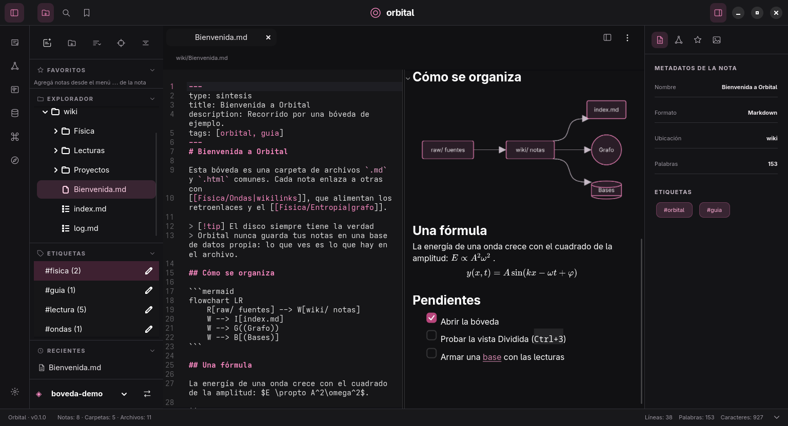

<div align="center">


# Orbital

**Markdown and HTML notes for Linux: fast, offline, and stored in files you own.**

[](https://github.com/caracelp/orbital/actions/workflows/ci.yml)
[](LICENSE)

[Español](README.md)



</div>

Orbital is a native GNOME app written in Rust with GTK4 and libadwaita. Your notes are plain
`.md` and `.html` files in a folder (the *vault*): no proprietary format, no account, no server.
It opens a 5,000-note vault in under half a second on a modest laptop.

The interface and the documentation are in **Spanish**.

## Highlights

- **The disk is the source of truth.** Every note is a regular file you can open in any editor,
  keep in git or sync however you like. Markdown and HTML notes are both first-class.
- **Editor** with three synchronized views (Code, Reading, Split), a foldable outliner, multiple
  cursors, autocompletion, editable YAML properties, autosave and per-note version history.
- **Links and graph**: wikilinks to notes, headings and blocks, backlinks, live transclusions,
  typed connections, a physics-based global graph and a local graph.
- **Bases**: table and card views over note properties, editable in place.
- **Canvas** and **mind maps**, **Mermaid diagrams** rendered natively, and **Visual Math**:
  LaTeX formulas, chemistry, units, and interactive 2D and 3D plots.
- **Media**: images, PDF, audio and video, carousels and galleries; **OnStage** presentations;
  HTML and PDF export; offline import of PDF, DOCX and HTML.
- **Optional Google Drive sync** to your own Drive, through your own Google Cloud project.
  Orbital has no servers and collects no data.

## Install

Build the Flatpak from source (no `sudo` needed):

```sh
git clone https://github.com/caracelp/orbital.git && cd orbital
flatpak remote-add --user --if-not-exists flathub https://dl.flathub.org/repo/flathub.flatpakrepo
flatpak install --user flathub org.gnome.Sdk//51 org.gnome.Platform//51 \
    org.freedesktop.Sdk.Extension.rust-stable//26.08
build-aux/flatpak/construir.sh
flatpak install --user build-aux/flatpak/build/orbital.flatpak
```

Or build with Cargo. You need stable Rust and the development files for GTK 4, libadwaita 1.8+,
GtkSourceView 5, WebKitGTK 6.0 and GStreamer (package names per distribution are listed in the
[Spanish README](README.md#desde-el-código)):

```sh
cargo build --release && target/release/orbital
```

## Performance

Measured on an Intel Celeron N5100 (no AVX), release build: startup to a drawn list with 5,000
notes in **425 ms**, 1.9 ms median keystroke latency in a 100 KB note, 7.2 ms full-text search
across 5,000 notes, 80 MB RSS at rest.

## Links

- Vault format: [docs/formato-boveda.md](docs/formato-boveda.md)
- Google Drive setup: [docs/google-drive-proyecto.md](docs/google-drive-proyecto.md)
- Contributing: [CONTRIBUTING.md](CONTRIBUTING.md) · Security: [SECURITY.md](SECURITY.md)
- Privacy policy: <https://caracelp.github.io/orbital/privacidad.html>

## License

[GPL-3.0-or-later](LICENSE).
