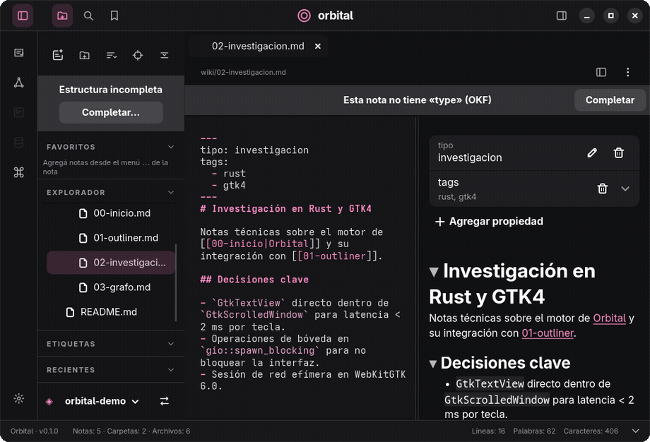
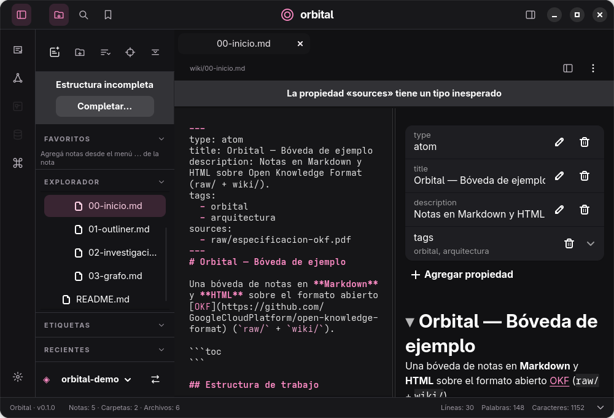
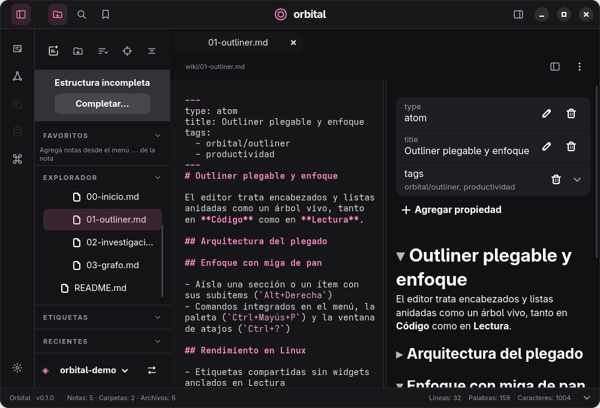

<div align="center">


# Orbital

**Notas en Markdown y HTML para Linux, hechas en Rust con GTK4 y libadwaita.**

El disco siempre tiene la verdad: tus notas son archivos `.md` y `.html` normales en una bóveda
[Open Knowledge Format](https://github.com/GoogleCloudPlatform/open-knowledge-format) `raw/` + `wiki/`,
compatible con otros editores. Ninguna función escribe HTML dentro de tus notas Markdown.

[](https://github.com/caracelp/orbital/actions/workflows/ci.yml)
[](LICENSE)


<br>



<br>

[Vistas](#vistas-y-outliner) · [Características](#características) · [Atajos](#atajos) · [Instalación](#flatpak) · [Compilar](#compilar-y-ejecutar) · [Contribuir](CONTRIBUTING.md)

</div>

---

## Vistas y outliner

<table>
  <tr>
    <td width="50%" align="center">
      
      <br>
      <sub><b>Vista Dividida y propiedades</b> — Código a la izquierda, Lectura formateada y propiedades YAML a la derecha.</sub>
    </td>
    <td width="50%" align="center">
      
      <br>
      <sub><b>Outliner plegable</b> — Plegado sincronizado entre Código y Lectura con estado persistente en <code>.orbital/plegado.yaml</code>.</sub>
    </td>
  </tr>
</table>

---

## Características

### Interfaz nativa de GNOME

- **Estética oscura rosa y negra** sobre GTK4 y libadwaita, con riel de navegación, pestañas que recuerdan cursor, vista y desplazamiento, y barra de estado con totales de la bóveda y de la selección.
- **Explorador y listas**: árbol de archivos, **Favoritos**, **Guardados** (colecciones personalizadas en `.orbital/listas.yaml`), etiquetas anidadas, recientes y selector de bóvedas recientes.
- **Barra derecha** con cuatro modos: propiedades y etiquetas de la nota, contexto (retroenlaces y enlaces entrantes), **grafo local por saltos** (1 · 2 · 3) y **galería de la nota** (`Ctrl+Alt+G`): las imágenes y videos de la nota abierta agrupados por encabezado (los de cada carrusel o galería, en su propio grupo), con búsqueda por nombre o encabezado, filtro por tipo, tres tamaños de mosaico, plegar y desplegar grupos, el visor a pantalla completa y «Ir al embed» (`Ctrl+Enter` en un mosaico o `E` en el visor), que lleva al editor con el embed resaltado. El menú de cada mosaico (clic derecho o `Mayús+F10`) copia la ruta o lo muestra en el explorador.
- **Paleta de comandos** (`Ctrl+Mayús+P`) y **selector rápido** (`Ctrl+P`).

### Editor y outliner

- **Tres vistas sincronizadas**: **Código** (`Ctrl+1`), **Lectura** (`Ctrl+2`) y **Dividida** (`Ctrl+3`).
- **Outliner plegable**: plegado de encabezados e ítems anidados en Código y Lectura con un único estado, atajos `Ctrl+Arriba` / `Ctrl+Abajo`, y **Enfocar** (`Alt+Derecha` / `Alt+Izquierda`) con miga de pan interactiva arriba del editor.
- **Edición de listas y multi-cursor**: `Enter` continúa el bloque, `Tab`/`Mayús+Tab` y `Alt+Arriba/Abajo` mueven subárboles enteros; multi-cursor con `Alt+clic`, `Alt+arrastre` y `Ctrl+Alt+Arriba/Abajo`.
- **Autocompletado y notas al pie**: wikilinks, bloques `^id`, etiquetas y estructuras, búsqueda y reemplazo en la nota, y notas al pie con tooltip en Lectura.
- **Ramas libres y notas en tres partes**: edición por bloques delimitados estilo Branch Writing / Gingko y estructura en 3 partes (propiedades, cuerpo, conexiones).

### Visualización y conocimiento

- **Grafo global de enlaces** a pantalla completa con simulación física Barnes-Hut en segundo plano, controles Pausar/Reanudar, Recalcular y anclaje al arrastrar.
- **Brújula de vecindario**: entrantes, salientes, mutuos y hermanas de segundo salto desde el riel izquierdo.
- **Canvas visual (`.canvas`)** con tarjetas de texto y de nota, y **Mapa mental** generado desde los encabezados y listas de la nota abierta.
- **OnStage**: presentá cualquier nota como diapositivas en vivo en una ventana separada, con portada, índice y modo *calm*.

### Búsqueda, archivos y privacidad

- **Búsqueda en toda la bóveda** (`Ctrl+Mayús+F`) con operadores `"frase"`, `-excluir`, `OR`, `tag:`, `path:`, `file:`, `line:`, `section:` y `[clave:valor]`.
- **Bases `.base`**: tablas y tarjetas con filtros combinados, columnas tipadas y edición de las propiedades de las notas originales; se incrustan con `![[archivo.base]]`. Renombrado y fusión de propiedades con vista previa, conflictos y deshacer.
- **Notas `.md` y `.html` de primera clase**, transclusiones vivas `![[nota]]` / `![[nota#sección]]`, plantillas con variables, nota diaria y papelera recuperable con deshacer.
- **Historial de versiones** automático al guardar (hasta 20 versiones por nota con diff y restaurar en `.orbital/historial/`).
- **PDFs e importación offline**: visor de PDF embebido con citas `#page=N&sel=i,f`, exportación a HTML autónomo y PDF, e importación offline de PDF/DOCX/HTML de `raw/` a Markdown.
- **100 % local**: todo corre sin conexión; la red solo interviene si pedís metadatos `og:` para tarjetas ` ```cardlink `, siempre con sesión efímera.

---

## Atajos

| Acción | Atajo |
|--------|-------|
| Nueva nota / abrir carpeta | `Ctrl+N` / `Ctrl+O` |
| Selector rápido / paleta de comandos | `Ctrl+P` / `Ctrl+Mayús+P` |
| Búsqueda global / buscar en la nota / reemplazar | `Ctrl+Mayús+F` / `Ctrl+F` / `Ctrl+H` |
| Vistas Código / Lectura / Dividida | `Ctrl+1` / `Ctrl+2` / `Ctrl+3` |
| Plegar / desplegar elemento del outliner | `Ctrl+Arriba` / `Ctrl+Abajo` |
| Enfocar elemento / subir un nivel en la miga | `Alt+Derecha` / `Alt+Izquierda` |
| Barra izquierda / derecha | `Ctrl+[` / `Ctrl+]` |
| Galería de la nota en la barra derecha | `Ctrl+Alt+G` |
| Retroenlaces / Nota diaria | `Ctrl+Mayús+B` / `Ctrl+Alt+D` |
| Exportar HTML / Pegar imagen | `Ctrl+Mayús+E` / `Ctrl+Mayús+V` |
| Renombrar / enviar a papelera | `F2` / `Supr` |
| Multi-cursor (Código) | `Alt+clic`, `Ctrl+Alt+Arriba/Abajo` |
| Preferencias / lista completa de atajos | `Ctrl+,` / `Ctrl+?` |

---

## Flatpak

```sh
cd ~/Proyectos/orbital                    # se corre desde la carpeta del repo
build-aux/flatpak/construir.sh            # genera build-aux/flatpak/build/orbital.flatpak
flatpak install --user build-aux/flatpak/build/orbital.flatpak
flatpak run io.github.caracelp.Orbital    # o desde el menú de aplicaciones
```

Usa el runtime de GNOME 51 y la extensión de Rust de Flathub (el script indica cómo instalarlos sin
`sudo`). El manifiesto para `flatpak-builder` está en
[`build-aux/flatpak/io.github.caracelp.Orbital.json`](build-aux/flatpak/io.github.caracelp.Orbital.json).

---

## Compilar y ejecutar

```sh
cargo run
```

Requiere Rust estable y las bibliotecas de desarrollo de GTK4, libadwaita, GtkSourceView 5 y
WebKitGTK 6.0:

- **Arch:** `gtk4`, `libadwaita`, `gtksourceview5`, `webkitgtk-6.0`
- **Debian/Ubuntu:** `libgtk-4-dev`, `libadwaita-1-dev`, `libgtksourceview-5-dev`, `libwebkitgtk-6.0-dev`

Herramientas de desarrollo:

```sh
cargo test -p orbital-vault                # núcleo sin GTK
cargo bench -p orbital-vault               # benchmarks del núcleo
cargo run -p orbital-vault --example generar-boveda -- /tmp/boveda N   # bóveda de prueba
orbital --captura salida.png [carpeta] [nota]                          # captura de la ventana
orbital --medir-escritura <carpeta> <nota>                             # latencia por tecla
orbital --salir-al-mostrar <carpeta>                                   # medir el arranque
```

---

## Verificación y formato de bóveda

Antes de cerrar cualquier cambio se corre el gate completo:

```sh
cargo fmt
cargo clippy --all-targets -- -D warnings
cargo test
cargo deny check
tools/pruebas-gtk.sh
```

- El contrato completo del disco (OKF v0.2, propiedades, bloques y `.orbital/`) vive en [docs/formato-boveda.md](docs/formato-boveda.md).
- El desarrollo sigue el flujo **Spec Kit** (`specs/NNN-nombre/`) con principios en [.specify/memory/constitution.md](.specify/memory/constitution.md) y estado en [docs/hoja-de-ruta.md](docs/hoja-de-ruta.md).
- Para contribuir, leé [CONTRIBUTING.md](CONTRIBUTING.md). Licencia **GPL-3.0-or-later** ([LICENSE](LICENSE)).
