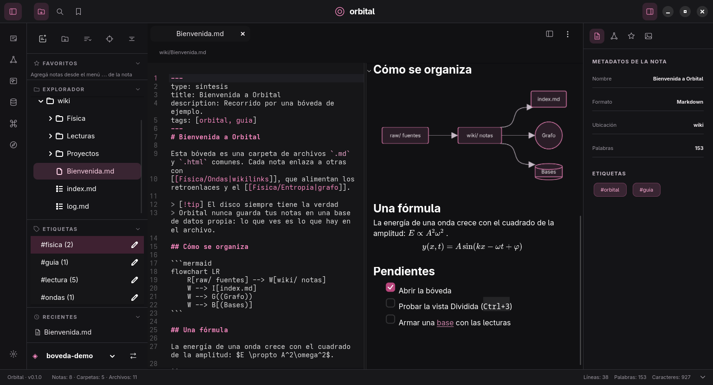
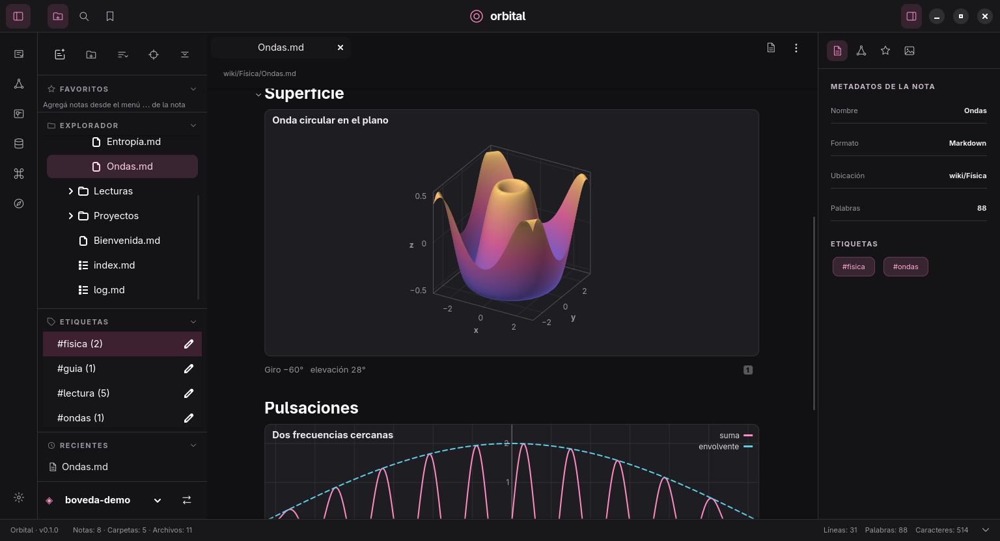
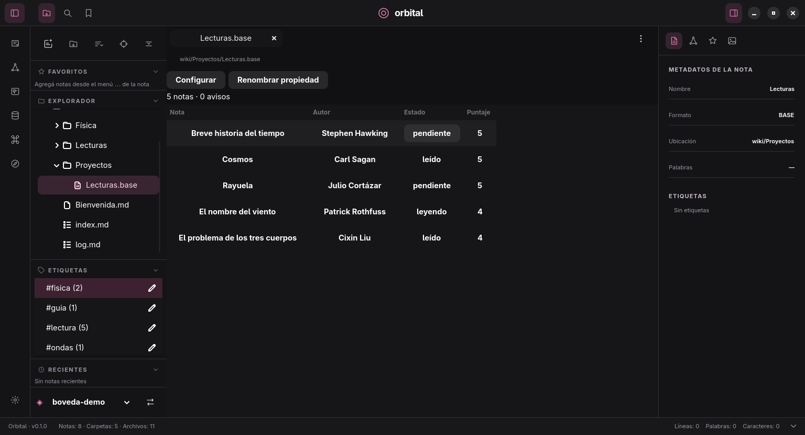

<div align="center">


# Orbital

**Notas en Markdown y HTML para Linux: rápidas, sin conexión y en archivos que son tuyos.**

Una app nativa de GNOME hecha en Rust con GTK4 y libadwaita. Tus notas son archivos `.md` y
`.html` comunes en una carpeta (la *bóveda*): ningún formato propietario, ninguna cuenta, ningún
servidor. Abre una bóveda de 5000 notas en menos de medio segundo en una computadora modesta.

[](https://github.com/caracelp/orbital/actions/workflows/ci.yml)
[](LICENSE)


[Funciones](#funciones) · [Instalación](#instalación) · [Bóveda](#la-bóveda) ·
[Rendimiento](#rendimiento) · [Documentación](docs/README.md) · [Contribuir](CONTRIBUTING.md) ·
[English](README.en.md)

<br>



</div>

## Por qué Orbital

- **El disco siempre tiene la verdad.** Cada nota es un archivo que podés abrir con cualquier
  editor, versionar con git o sincronizar como quieras. Nada se guarda en una base de datos
  propia, y ninguna función escribe HTML dentro de tus notas Markdown.
- **Markdown y HTML, los dos de primera clase.** Markdown para las notas atómicas; HTML para las
  notas de síntesis, con su propia vista visual.
- **Rendimiento primero.** Escrito en Rust, sin Electron: el Markdown, las fórmulas, los
  gráficos y los diagramas se dibujan de forma nativa, y WebKitGTK se carga solo cuando hace
  falta (notas HTML y PDF). Se mide en un Intel Celeron N5100 sin AVX.
- **Sin conexión.** Todo funciona sin red. La única conexión opcional es la sincronización con tu
  propio Google Drive.
- **Software libre** (GPL-3.0-or-later).

## Funciones

<table>
  <tr>
    <td width="50%" valign="top">
      
      <br><sub><b>Visual Math</b>: fórmulas LaTeX, química y gráficos 2D y 3D interactivos, escritos en la nota.</sub>
    </td>
    <td width="50%" valign="top">
      
      <br><sub><b>Bases</b>: tablas y tarjetas sobre las propiedades de tus notas, editables en el lugar.</sub>
    </td>
  </tr>
</table>

### Editor

- Tres vistas sincronizadas por nota: **Código** (`Ctrl+1`), **Lectura** (`Ctrl+2`) y
  **Dividida** (`Ctrl+3`). Las notas HTML tienen además una vista **Visual** para editarlas
  directamente.
- **Outliner plegable**: encabezados e ítems se pliegan en Código y Lectura con un único estado
  guardado; **Enfocar** un elemento (`Alt+Derecha`) con miga de pan para volver.
- Listas que se editan solas (`Enter`, `Tab`, `Alt+Arriba/Abajo` mueven subárboles), varios
  cursores (`Alt+clic`, `Ctrl+Alt+Arriba/Abajo`), buscar y reemplazar en la nota.
- Autocompletado de enlaces, bloques `^id`, etiquetas y propiedades; notas al pie con vista previa;
  callouts, casillas de tareas y resaltado de código en Lectura; números de línea en Código.
- **Propiedades** YAML editables como formulario, con tipos y avisos cuando algo no cuadra.
- **Ramas libres** y notas en tres partes (propiedades, cuerpo y conexiones) para escribir por
  bloques jerárquicos.
- Guardado automático, **historial de versiones** por nota (hasta 20, con diferencias y
  restaurar) y papelera recuperable.

### Enlaces y grafo

- Wikilinks `[[nota]]`, `[[nota#sección]]` y `[[nota#^bloque]]`, retroenlaces y enlaces
  entrantes; renombrar una nota actualiza los enlaces que la nombran.
- **Transclusiones** vivas `![[nota]]` y `![[nota#sección]]`.
- **Grafo global** con simulación física (Barnes-Hut en segundo plano), **grafo local** de 1 a 3
  saltos y **brújula** de la nota abierta (entrantes, salientes, mutuos y hermanas).
- **Conexiones con tipo y motivo** (`- amplía:: [[Derivadas]] — agrega la regla de la cadena`).
- Etiquetas anidadas, campos en línea `clave:: valor`, **consultas vivas** e **índices por
  etiqueta** que se actualizan solos sin escribir en el disco.

### Bases

- Archivos `.base`: vistas de **tabla** o **tarjetas** sobre las notas, con filtros por carpeta,
  etiqueta o propiedad, columnas tipadas y orden.
- Editar una celda cambia la propiedad en la nota original (con comprobación de cambios
  externos). Se incrustan en cualquier nota con `![[archivo.base]]`.
- Renombrar o fusionar propiedades en toda la bóveda, con vista previa, conflictos y deshacer.

### Canvas y mapa mental

- **Canvas** (`.canvas`): un lienzo infinito con tarjetas de texto y de nota, y conexiones.
- **Mapa mental** generado al vuelo desde los encabezados y las listas de la nota abierta.

### Visual Math

- Fórmulas **LaTeX** en línea (`$…$`) y en bloque (`$$…$$`), dibujadas de forma nativa, y un
  **editor de ecuaciones** con vista previa (`Ctrl+M`).
- **Química** (`\ce{…}`) y **unidades** (`\qty`, `\SI`, `\pu`).
- **Gráficos** ` ```grafico `: funciones, paramétricas, polares, implícitas, puntos y tablas de
  datos en 2D, y superficies y curvas en **3D** que se giran con el mouse; parámetros con
  deslizadores.

### Diagramas Mermaid

- Bloques ` ```mermaid ` (flujo, secuencia, clases, estados, Gantt, mapas mentales, líneas de
  tiempo y más) dibujados sin navegador, con el tema de la app; se amplían y se copian como imagen.

### Medios y galerías

- Imágenes, PDF, **audio y video** incrustados (`![[archivo]]`), con reproductores nativos que
  no abren el archivo hasta que tocás reproducir.
- **Carrusel** de medios, **galería** dentro de la nota y **galería lateral** (`Ctrl+Alt+G`) con
  todos los medios de la nota agrupados por encabezado y un visor a pantalla completa.
- Visor de **PDF** con citas a una página o a una selección.

### OnStage

- Presentá cualquier nota como diapositivas en una ventana aparte, con portada, índice y
  fórmulas, gráficos y diagramas incluidos.

### Exportar e importar

- Exportar una nota a **HTML** autónomo (`Ctrl+Mayús+E`) o a **PDF**.
- Importar sin conexión **PDF**, **DOCX** y **HTML** de `raw/` como notas Markdown.
- Plantillas con variables, nota diaria (`Ctrl+Alt+D`) y tarjetas de estudio.

### Búsqueda y navegación

- Búsqueda en toda la bóveda (`Ctrl+Mayús+F`) con operadores: `"frase"`, `-excluir`, `OR`,
  `tag:`, `path:`, `file:`, `line:`, `section:` y `[clave:valor]`; búsquedas guardadas.
- **Selector rápido** (`Ctrl+P`), **paleta de comandos** (`Ctrl+Mayús+P`), pestañas que recuerdan
  la vista y la posición, **Favoritos** y listas **Guardados**.

### Google Drive (opcional)

- Espejo de la bóveda con una carpeta de **tu** Google Drive, usando **tu propio proyecto** de
  Google Cloud. Nunca borra: lo que sale va a la papelera; si una nota cambió en los dos lados, la
  fusiona o te deja elegir. Las credenciales van al llavero del sistema.
  Cómo prepararlo: [docs/google-drive-proyecto.md](docs/google-drive-proyecto.md).

La lista completa de atajos está en [docs/atajos.md](docs/atajos.md) y dentro de la app
(`Ctrl+?`).

## Instalación

### Flatpak

Por ahora el Flatpak se arma desde el código, con las herramientas de `flatpak` y sin `sudo`:

```sh
git clone https://github.com/caracelp/orbital.git
cd orbital
flatpak remote-add --user --if-not-exists flathub https://dl.flathub.org/repo/flathub.flatpakrepo
flatpak install --user flathub org.gnome.Sdk//51 org.gnome.Platform//51 \
    org.freedesktop.Sdk.Extension.rust-stable//26.08
build-aux/flatpak/construir.sh            # genera build-aux/flatpak/build/orbital.flatpak
flatpak install --user build-aux/flatpak/build/orbital.flatpak
flatpak run io.github.caracelp.Orbital
```

El manifiesto para `flatpak-builder` está en
[`build-aux/flatpak/io.github.caracelp.Orbital.json`](build-aux/flatpak/io.github.caracelp.Orbital.json).

### Desde el código

Hace falta Rust estable (2024 edition) y las bibliotecas de desarrollo de GTK 4.14 o más nueva,
**libadwaita 1.8** o más nueva, GtkSourceView 5, WebKitGTK 6.0 y GStreamer:

| Distribución | Paquetes |
|---|---|
| Arch Linux | `base-devel gtk4 libadwaita gtksourceview5 webkitgtk-6.0 gstreamer gst-plugins-good` |
| Fedora 43 o más nueva | `gcc pkgconf-pkg-config gtk4-devel libadwaita-devel gtksourceview5-devel webkitgtk6.0-devel gstreamer1-devel gstreamer1-plugins-good` |
| Ubuntu 25.10 o más nueva | `build-essential pkg-config libgtk-4-dev libadwaita-1-dev libgtksourceview-5-dev libwebkitgtk-6.0-dev libgstreamer1.0-dev gstreamer1.0-plugins-good` |

En distribuciones con una libadwaita anterior a la 1.8 (por ejemplo Debian 13), usá el Flatpak.
El paquete de WebKitGTK es el de GTK4 (`webkitgtk-6.0`), no el de GTK3 (`webkit2gtk-4.1`).

```sh
git clone https://github.com/caracelp/orbital.git
cd orbital
cargo build --release
target/release/orbital                    # o: target/release/orbital <carpeta>
```

## La bóveda

```
mi-bóveda/
├── raw/        fuentes que Orbital nunca modifica (PDF, documentos, imágenes)
├── wiki/       tus notas .md y .html, en las carpetas que quieras
│   ├── index.md
│   └── log.md
└── .orbital/   lo propio de Orbital (historial, papelera, búsquedas); borrarla no pierde notas
```

- **Abrir** cualquier carpeta funciona: Orbital la lee sin cambiarle nada. **Abrir como bóveda
  de Orbital** completa la estructura de arriba.
- La estructura sigue el formato abierto
  [Open Knowledge Format](https://github.com/GoogleCloudPlatform/open-knowledge-format) (OKF
  v0.2): propiedades `type`, `title`, `description` y `tags` en el frontmatter YAML.
- Todo lo que Orbital lee y escribe está documentado en
  [docs/formato-boveda.md](docs/formato-boveda.md), para que cualquier otra herramienta (un
  editor, un script o un asistente) pueda trabajar sobre la misma bóveda.

## Rendimiento

Medido en un **Intel Celeron N5100** (4 núcleos, sin AVX, 7,6 GiB de RAM), compilación de
release, con bóvedas generadas de prueba:

| Qué | Resultado |
|---|---|
| Arranque hasta la lista dibujada, bóveda de 5000 notas | **425 ms** (mediana de 15 corridas) |
| Recorrido de 5000 notas / lectura de sus propiedades | 14 ms / 75 ms |
| Índice de búsqueda de 5000 notas / buscar una palabra | 160 ms / 7,2 ms (9,5 MB de memoria) |
| Latencia por tecla en una nota de 100 KB (resaltado y ajuste de línea) | mediana 1,9 ms, p99 3,3 ms |
| Grafo de 5000 nodos: paso de la simulación / dibujo de un cuadro | 7,2 ms / 1,2 ms |
| Memoria en reposo con 5000 notas, sin notas HTML abiertas | 80 MB RSS |

Cómo reproducirlas: `cargo bench -p orbital-vault`, `orbital --salir-al-mostrar <carpeta>` (con
`ORBITAL_MEDIR_ARRANQUE=1` muestra cada etapa) y `orbital --medir-escritura <carpeta> <nota>`.
Las bóvedas de prueba se generan con
`cargo run --release -p orbital-vault --example generar-boveda -- /tmp/boveda 5000`.

## Contribuir

Los errores y pedidos van por [issues](https://github.com/caracelp/orbital/issues); las ideas
abiertas, por [discussions](https://github.com/caracelp/orbital/discussions). Antes de mandar un
cambio, leé [CONTRIBUTING.md](CONTRIBUTING.md): explica el entorno, las verificaciones
(`cargo fmt`, `cargo clippy`, `cargo test`, `cargo deny`) y las reglas de rendimiento. Para
reportar un problema de seguridad, [SECURITY.md](SECURITY.md).

## Privacidad

Orbital no recoge datos ni tiene servidores. Detalles en la
[política de privacidad](https://caracelp.github.io/orbital/privacidad.html).

## Licencia

[GPL-3.0-or-later](LICENSE). PDF.js (en `assets/pdfjs/`) se distribuye bajo su licencia
Apache-2.0 y las fuentes KaTeX (en `crates/orbital-formulas/fuentes-katex/`), bajo la SIL Open
Font License 1.1.
