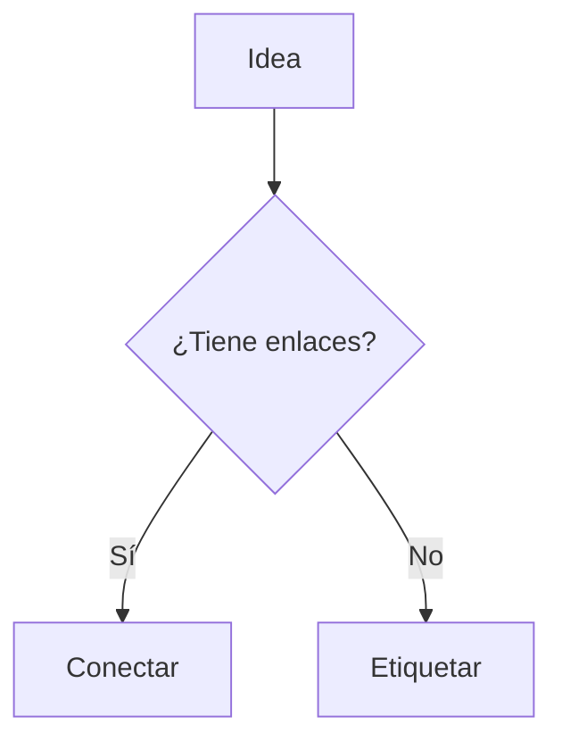

# Contrato: formato en disco de una bóveda de Orbital (versión 1)

Documento público del formato (FR-032). Es la fuente de verdad: si el código y este documento no coinciden,
el error está en el código. Define lo que cualquier herramienta
(otro editor, un agente, un script) puede esperar de una bóveda de Orbital y lo que tiene que respetar.

## 1. Estructura

```
<bóveda>/
├── raw/          fuentes inmutables
├── wiki/         notas y archivos de trabajo
│   ├── index.md  reservado
│   └── log.md    reservado
├── AGENTS.md     opcional
└── .orbital/     propio de Orbital
```

- Una carpeta sin esta estructura sigue siendo legible: Orbital la abre con **Abrir** y no la cambia.
- `raw/`: Orbital nunca modifica, renombra ni borra nada de esta carpeta. Solo agrega archivos copiados.
- `wiki/`: todo lo demás. Las subcarpetas son libres. Las funciones identifican las notas por `type`, no por
  carpeta.
- `.orbital/`: `config.yaml`, `respaldo/`, `papelera/` (solo se usa si el disco no tiene papelera del
  sistema, por ejemplo tmpfs o FAT), `busquedas.yaml`, `enlaces.yaml`, `historial/` y, con la bóveda
  en Google Drive, `drive.yaml`, `conflictos/` y `sincronizacion/` (secciones 9 y 12.1). Ninguna otra herramienta debería escribir aquí. Borrarla no pierde contenido de las notas.

## 2. Elementos ocultos

Cualquier archivo o carpeta cuyo nombre empiece con `.` (por ejemplo `.orbital/` o `.git/`) queda fuera de
toda lista, búsqueda, enlace, índice y embedding.

## 3. Notas atómicas (`.md`)

UTF-8, con frontmatter YAML 1.2 entre dos líneas `---` al inicio (después de un BOM opcional), según OKF v0.2
§4. Cuerpo en Markdown.

```markdown
---
type: atomo
title: Entropía
description: Medida del desorden de un sistema.
tags: [fisica, termodinamica]
created: 2026-11-09T18:30:00-03:00
generated: { by: human:ejemplo, at: 2026-11-09T18:30:00-03:00 }
sources:
  - id: callen
    resource: /raw/callen-termodinamica.pdf
---
# Entropía
...
```

## 4. Notas de síntesis (`.html`)

Documento HTML. Las propiedades van en **una sola** etiqueta `<script type="application/yaml">` dentro de
`<head>`, con el mismo YAML que el frontmatter. Los navegadores no muestran ni ejecutan ese bloque.

```html
<!doctype html>
<html lang="es">
<head>
  <meta charset="utf-8">
  <title>Termodinámica</title>
  <script type="application/yaml">
type: sintesis
title: Termodinámica
tags: [fisica]
  </script>
</head>
<body>…</body>
</html>
```

- Un valor que contenga `</` se escribe entre comillas dobles con la barra escapada: `"<\/script>"`.
- Si hay más de una etiqueta de este tipo, solo cuenta la primera. Orbital avisa.
- El JavaScript de la nota y su aislamiento se definen en la especificación de las notas HTML.

### 4.1. Estilos de Orbital (`<style data-orbital>`)

Para que el HTML se mantenga limpio y legible tanto en la vista Código como en editores externos o
navegadores, Orbital nunca inserta atributos `style="..."` en línea al aplicar formatos desde la vista
Visual (FR-014b). En su lugar, utiliza clases semánticas con prefijo `o-` cuyas reglas se agrupan en una
única etiqueta `<style data-orbital>` dentro del `<head>`:

```html
<head>
  ...
  <style data-orbital>
.o-color-rosa { color: #ff8cc6; }
.o-columnas-2 { column-count: 2; column-gap: 2em; }
  </style>
</head>
```

- **Clases estándar reconocidas**:
  - **Color de texto**: `o-color-rosa`, `o-color-rojo`, `o-color-naranja`, `o-color-amarillo`, `o-color-verde`,
    `o-color-azul`, `o-color-violeta`, `o-color-gris`.
  - **Color de fondo**: `o-fondo-rosa`, `o-fondo-rojo`, `o-fondo-naranja`, `o-fondo-amarillo`, `o-fondo-verde`,
    `o-fondo-azul`, `o-fondo-violeta`, `o-fondo-gris`.
  - **Alineación**: `o-alinear-izquierda`, `o-alinear-centro`, `o-alinear-derecha`, `o-alinear-justificado`.
  - **Columnas**: `o-columnas-2`, `o-columnas-3`.
  - **Estilos de bloque**: `o-estilo-destacado` (borde rosa y realce), `o-estilo-nota` (bloque azul con fondo suave),
    `o-estilo-advertencia` (bloque amarillo con fondo suave).
- **Regla de edición**: Al guardar desde la vista Visual, el bloque `<style data-orbital>` es la **única**
  parte de `<head>` que Orbital puede agregar o actualizar (solo incluyendo las reglas de las clases
  efectivamente utilizadas en el documento). Todo el resto de `<head>` (metadatos, estilos propios de la
  nota, scripts) y el bloque de propiedades se conservan byte a byte (FR-015).


## 5. Propiedades

- Obligatoria en `wiki/`: `type` (no bloqueante; Orbital avisa si falta).
- Reconocidas: las de OKF v0.2 (`type`, `title`, `description`, `resource`, `tags`, `status`, `sources`,
  `generated`, `verified`, `stale_after`) y las de Orbital (`aliases`, `archived`, `created`, `updated`).
- Valores de `type` usados por Orbital: `atomo`, `sintesis`, `plantilla`, `diario`. Se aceptan otros
  (tipos libres, como `cuaderno`): no son un error.
- `tipo` es alias pleno de `type`: una nota con `tipo: cuaderno` tiene tipo `cuaderno` y no recibe el
  aviso de que falta `type`. Orbital no le agrega `type` y, si cambia el tipo (por ejemplo desde Bases),
  escribe en `tipo`. Si una nota tiene las dos claves, **gana `type`** y `tipo` se conserva sin usarse.
  Las notas nuevas se crean con `type`.
- `id` (040/041): identificador de la nota, `<PREFIJO>-NNN` (`AT-001`). El prefijo sale del tipo: tabla
  fija (`atomo` → `AT`, `apunte` → `AP`, `concepto` → `CO`, `cuaderno` → `CU`…) o, para un tipo libre,
  su primera letra y la siguiente que no forme un prefijo de la tabla (`cosa` → `CS`, `cuento` → `CE`).
  El prefijo depende solo del nombre del tipo; dos tipos libres pueden compartirlo. El número es el
  primero libre en **toda la bóveda**: cuenta los `id` de todas las notas y los ids de los delimitadores
  `<!-- block … ID -->`, `<!-- summary ID -->`, `<!-- sources ID -->` y `<!-- connections ID -->`.
  Orbital solo pone un `id` cuando se le pide (Estructurar en 3 partes, una parte opcional, Ramas
  libres). Si dos notas tienen el mismo id, avisa en la nota (sin bloquear ni reescribir nada).
- Las fechas con hora llevan desplazamiento explícito (OKF §5).
- Las claves desconocidas se conservan. Editar una propiedad no cambia el resto del bloque ni del archivo.

## 6. Enlaces

- Wikilinks: `[[nombre]]`, `[[nombre|alias]]`, `[[nombre#encabezado]]`, `[[nombre#^bloque]]`. Se resuelven por nombre de archivo
  dentro de `wiki/`. Si `nombre` coincide con un `.md` y un `.html`, el enlace es ambiguo; `[[nombre.html]]`
  lo resuelve.
- Markdown estándar: `[texto](/ruta.md)` relativo a la raíz de `wiki/` (forma recomendada por OKF §6.1) o
  `[texto](./ruta.md)` relativo a la nota.
- Un enlace a una nota inexistente es válido: representa una nota por escribir.
- Transclusiones: un párrafo que es solo `![[nombre]]` o `![[nombre#encabezado]]` muestra el contenido de esa
  nota (o de esa sección: el encabezado y lo que sigue hasta otro del mismo nivel o mayor) en la vista
  formateada. Se resuelven como los wikilinks. Se anidan hasta 3 niveles; una referencia circular se muestra
  como aviso. En las notas `.html` el archivo guarda solo el texto `![[…]]`: la tarjeta la dibuja Orbital y
  nunca se escribe en el archivo.
- Identificadores de bloque (026): al guardar una nota de `wiki/`, Orbital le pone un id a cada bloque que
  no lo tiene (párrafos, cada ítem de lista, citas, callouts, tablas, bloques de código y `$$`). El bloque
  donde está el cursor lo recibe al guardar con el cursor en otro bloque o al dejar la nota. Abrir y dejar
  una nota sin cambios no la modifica; `raw/` nunca se toca. En Código y en el archivo se ven; en Lectura,
  la búsqueda, exportar y OnStage, no.

  ~~~markdown
  La entropía mide el desorden de un sistema. ^k3x9a1

  - Primer principio ^p2m8q4
    - Un subítem ^r5t1w9

  > Una cita de varias líneas
  > que termina acá. ^c8h2n6

  | a | b |
  |---|---|
  | 1 | 2 |
  ^t9y3u1

  ```rust
  fn main() {}
  ```
  ^q1w2e3
  ~~~

  - El id es `^` + letras, dígitos o guiones (Orbital genera 6 caracteres `a-z0-9`), separado por un
    espacio al final del bloque; en tablas, código y `$$`, solo en la línea siguiente. Un id escrito a
    mano (o por otra herramienta) se respeta; si se repite en la nota, Orbital reemplaza los siguientes.
  - Los encabezados se enlazan por su texto (`[[nota#Encabezado]]`) y no llevan id; el frontmatter
    tampoco.
  - En las notas `.html` el id es el atributo `id` de `p`, `li`, `blockquote`, `table`, `pre` y `figure`
    (`<p id="k3x9a1">…</p>`), también desde la vista Visual.
  - `[[nota#^k3x9a1]]` (o `[texto](/ruta/nota.md#^k3x9a1)`) lleva al bloque y lo resalta; `[[#^k3x9a1]]`
    es un bloque de la misma nota. `![[nota#^k3x9a1]]`, solo en su párrafo, incrusta ese bloque (un ítem,
    con sus subítems). Al escribir `[[nota#^` se sugieren los bloques de esa nota con su texto.
- Al renombrar o mover una nota, Orbital ofrece actualizar los enlaces que **resuelven** a ella (no los que
  solo comparten el nombre). De cada enlace cambia solo la ruta, en el mismo estilo (con o sin carpeta o
  extensión, `/…` o relativa); alias, anclas y el resto del archivo quedan iguales.

## 7. `wiki/index.md` y `wiki/log.md`

Formato de OKF v0.2 §8 y §9.

```markdown
# atomo

* [Entropía](/entropia.md) - Medida del desorden de un sistema.

# sintesis

* [Termodinámica](/termodinamica.html) - Panorama de la termodinámica clásica.
```

```markdown
# Registro de la wiki

## 2026-11-09
* **Creación**: [Entropía](/entropia.md)
* **Renombre**: [Calor](/calor.md) (antes `temperatura.md`)
```

- Orbital agrega, cambia y quita solo las líneas `* [Título](ruta) - descripción` que apuntan a notas, y las
  entradas de `log.md` del día en curso. El resto del texto no lo toca.
- Orbital no crea estos archivos salvo con **Abrir como bóveda de Orbital**.

## 8. Plantillas y diario

- Plantilla: nota con `type: plantilla`. Variables: `{{fecha}}`, `{{hora}}`, `{{titulo}}`, `{{carpeta}}`.
- Nota diaria: `wiki/<AAAA-MM-DD>.md` con `type: diario` (el nombre se configura).

## 9. Archivos auxiliares

- `.base` y `.canvas`: texto legible en YAML o JSON (JSON también es YAML válido) con `format_version`
  entero. Si falta o el archivo tiene errores, Orbital lo muestra y no lo sobrescribe sin confirmación. Su
  contenido se especifica en sus propias funciones.
- `.orbital/config.yaml`: `format_version`, `link_style` (`wikilink` | `markdown`), `journal_name`, `actor`.
- `.orbital/busquedas.yaml` (004): búsquedas guardadas, una lista de mapas `name`/`query`. Escritura
  atómica con respaldo; si el YAML tiene errores, Orbital avisa y no lo sobrescribe.
- `.orbital/enlaces.yaml` (009): archivos de `raw/` asociados a una URL, una lista de mapas
  `ruta`/`url`. La ruta es relativa a la raíz de la bóveda y la URL es `http` o `https`. Al
  renombrar o mover el archivo, la entrada se actualiza.

  ```yaml
  - ruta: raw/callen-termodinamica.pdf
    url: https://ejemplo.com/termodinamica
  ```

- `.orbital/historial/<ruta>/` (010): versiones automáticas del contenido **previo** a cada guardado,
  un archivo de texto por versión con nombre `AAAA-MM-DD_HH-MM-SS.txt` (milisegundos y sufijo
  incremental si hace falta). Máximo 20 versiones por nota: se descartan las más viejas. Un guardado
  que no cambia el contenido no crea versión duplicada. Las versiones nunca son notas: no entran en
  la búsqueda, el grafo ni las listas.

- `.orbital/listas.yaml` (027): Favoritos y Guardados de la bóveda. Viaja con la carpeta:
  sincronizarla o copiarla los lleva.

  ```yaml
  format_version: 1
  favoritos:
    - wiki/entropia.md
    - raw/callen-termodinamica.pdf
  colecciones:
    - nombre: Para leer
      notas:
        - wiki/segundo-principio.html
        - wiki/entropia.md
    - nombre: "Tesis: capítulo 2"
      notas: []
  ```

  - `format_version`: entero, hoy `1`. Si falta se asume `1`; uno mayor que el que Orbital entiende
    se trata como archivo dañado (no se pisa).
  - `favoritos`: lista de rutas, en el orden en que se muestran.
  - `colecciones`: lista de mapas con `nombre` (texto no vacío, único sin distinguir mayúsculas) y
    `notas` (lista de rutas en orden; puede estar vacía). Las colecciones no se anidan.
  - Las claves que faltan valen como listas vacías. Un archivo vacío o ausente = sin favoritos ni
    colecciones.
  - Una ruta es relativa a la raíz de la bóveda, con `/`, sin componentes ocultos ni `..`. Puede ser
    una nota de `wiki/` (`.md` o `.html`) o cualquier archivo que Orbital abre, también de `raw/`.
  - Una ruta repetida dentro de la misma lista se toma una sola vez (la primera). Una ruta que no
    existe se conserva y Orbital la muestra como faltante, con la opción de quitarla.

  Cómo lo trata Orbital:

  - Lo crea (y crea `.orbital/`) recién al marcar el primer favorito o crear la primera colección.
  - Escritura atómica. Antes de escribir encima de un contenido que no escribió esta misma sesión de
    Orbital (el que había al abrir la bóveda, uno cambiado por fuera o uno dañado), lo copia a
    `.orbital/respaldo/<fecha>/.orbital/listas.<hora>.yaml`. Los cambios siguientes de la misma
    sesión (reordenar, marcar) no dejan más copias.
  - Si el archivo tiene errores (YAML inválido, claves desconocidas, rutas inválidas, nombres de
    colección vacíos o repetidos), Orbital avisa una vez, muestra las listas vacías y no lo
    sobrescribe hasta que la usuaria haga un cambio; ese cambio respalda primero el archivo dañado.
  - Si el archivo cambia afuera mientras Orbital está abierto, lo vuelve a leer. Si cambió entre la
    lectura y una escritura, lo vuelve a leer y repite el cambio sobre lo nuevo.
  - Renombrar o mover un archivo o una carpeta desde Orbital actualiza las rutas; borrar desde
    Orbital quita las entradas (y «Deshacer» las repone). Lo que se borra o mueve por fuera queda
    como faltante.
  - Ninguna nota ni archivo de `raw/` se modifica.

- `.orbital/plegado.yaml` (028): qué partes de cada nota están plegadas (outliner plegable). Viaja
  con la carpeta: sincronizarla o copiarla lo lleva. Las notas nunca cambian por plegar.

  ```yaml
  format_version: 1
  notas:
    - ruta: wiki/entropia.md
      plegados:
        - encabezado: Historia
        - encabezado: Ejemplos
          aparicion: 2
        - bloque: p2m8q4
        - item: Comprar pan
    - ruta: "wiki/proyectos/tesis: capítulo 2.md"
      plegados:
        - encabezado: Bibliografía
  ```

  - `format_version`: entero, hoy `1`. Si falta se asume `1`; uno mayor que el que Orbital entiende
    se trata como archivo dañado y no se pisa.
  - `notas`: lista de mapas con `ruta` y `plegados`, ordenada por ruta. Solo aparecen las notas con
    algo plegado.
  - `ruta`: relativa a la raíz de la bóveda, con `/`, sin componentes ocultos ni `..`; una nota
    `.md`. Una ruta repetida daña el archivo.
  - `plegados`: lista (no vacía) de pliegues, en el orden en que aparecen en la nota. Cada pliegue
    es un mapa con **una** de estas claves:
    - `bloque: <id>`: el ítem de lista cuya primera línea termina en `^<id>` (el identificador de
      bloque de la 026). Es la forma preferida: sobrevive a cambios en el texto del ítem.
    - `item: <texto>`: un ítem de lista sin identificador, por el texto de su primera línea (sin el
      marcador `-`/`*`/`+`/`1.`, sin la casilla `[ ]` y recortado).
    - `encabezado: <texto>`: una sección, por el texto de su encabezado (sin los `#`, recortado).
    - `aparicion: <n>` (opcional, con `item` o `encabezado`; entero ≥ 1, por defecto 1): cuál de los
      elementos con ese mismo texto, contando desde el principio de la nota.
  - Un pliegue que ya no corresponde a nada de la nota no pliega nada; Orbital lo quita la próxima
    vez que escribe el estado de esa nota. Nunca pliega otro elemento en su lugar.

  Cómo lo trata Orbital:

  - Lo lee en segundo plano al abrir la primera nota `.md` de la bóveda (no en el arranque).
  - Lo crea (y crea `.orbital/`) recién al plegar algo por primera vez.
  - Escritura atómica. Antes de escribir encima de un contenido que no escribió esta misma sesión de
    Orbital (el que había al abrir la bóveda, uno cambiado por fuera o uno dañado), lo copia a
    `.orbital/respaldo/<fecha>/.orbital/plegado.<hora>.yaml`. Plegar y desplegar muchas veces en la
    misma sesión no deja más copias.
  - Al escribir, quita las notas que ya no existen en la bóveda.
  - Si el archivo tiene errores (YAML inválido, claves desconocidas, una ruta inválida o repetida,
    un pliegue sin clave o con dos, `aparicion` no entero o menor que 1), Orbital avisa una vez,
    abre las notas desplegadas y no lo sobrescribe hasta que la usuaria pliegue o despliegue algo;
    ese cambio respalda primero el archivo dañado.
  - Si cambió en disco entre la lectura y una escritura (otra computadora, un editor), lo vuelve a
    leer y repite el cambio sobre lo nuevo. No hay vigilante: un cambio de afuera se ve la próxima
    vez que se abre la bóveda.
  - Renombrar o mover una nota o una carpeta desde Orbital actualiza las rutas; borrar desde Orbital
    quita las entradas (y «Deshacer» las repone). Lo que se borra o mueve por fuera se descarta al
    escribir.
  - El enfoque (ver solo un elemento) no se guarda.
- `.orbital/drive.yaml` (061a): la conexión de la bóveda con una carpeta de Google Drive. Viaja con
  la bóveda (también se sincroniza) y **no tiene secretos**: las credenciales están en el llavero del
  sistema y el estado de sincronización de cada equipo, fuera de la bóveda
  (`$XDG_STATE_HOME/orbital/drive/<id>/`). Si no existe, la bóveda no está conectada y Orbital no
  carga nada de la sincronización.

  ```yaml
  # Orbital: conexión con Google Drive (061). No contiene secretos.
  cuenta: "nombre@gmail.com"
  carpeta: "1AbC…"        # id de la carpeta raíz de la bóveda en Drive
  solo_local:             # nunca se suben, en ningún equipo
    - "wiki/privado/"     # una carpeta termina en `/`
    - "borrador.md"
  ```

  - Se sincroniza todo lo que no esté en `solo_local`, salvo lo oculto: de `.orbital/` solo viajan
    `config.yaml`, `drive.yaml`, `listas.yaml`, `plegado.yaml`, `enlaces.yaml` y `busquedas.yaml`;
    `historial/`, `respaldo/`, `papelera/` y `conflictos/` son de cada equipo.
  - Lo que se reemplaza o se saca por la sincronización nunca se borra: si Drive no lo tenía, va al
    historial (notas de texto) o a `.orbital/respaldo/<fecha>/<ruta>`; lo borrado en Drive va a la
    papelera; lo borrado acá va a la papelera de Drive.
- `.orbital/conflictos/<ruta>/<fecha>.<ext>` (061a): la versión de Drive de un archivo que cambió en
  este equipo y en Drive a la vez. Mientras exista el conflicto no se sube nada encima. Al resolverlo
  («Conservar la de este equipo» o «Usar la de Drive»), la versión descartada pasa al historial o al
  respaldo y la copia se quita. Si los cambios de los dos lados de una nota `.md` o `.html` no tocan
  los mismos renglones, se unen solos y las dos originales quedan en el historial.
- `.orbital/sincronizacion/` (061a): bajadas a medio hacer (`<id>-<suma>.parcial`); se pueden borrar.

## 10. Borrar y papelera

Borrar nunca es definitivo: el archivo va a la papelera del sistema y, si ese disco no tiene (tmpfs, FAT),
a `.orbital/papelera/<fecha>-<hora>/<ruta>`. En los dos casos se puede deshacer, y la línea de `index.md` se
repone tal como estaba.

## 11. Versionado

Este contrato tiene `format_version: 1`. Un cambio incompatible sube la versión y trae una guía de migración.

## 12. Contenido generado (005)

Texto del archivo que la vista expande al leer: el disco siempre tiene el fuente, y la generación es
solo de vista (no entra en la búsqueda ni en el grafo). En Lectura y Visual se muestra el contenido
generado; en Código queda el texto plano.

### Marcadores `[%clave]`

- Sintaxis de Orbital. La clave usa el mismo criterio de los campos inline (sin
  espacios, `:`, comillas ni delimitadores) y el cierre `]` va en la misma línea.
- No cuentan los que están dentro de código (cercas, en línea, bloques), enlaces, imágenes,
  frontmatter o escapados con `\`.
- Resolución, en orden: campo inline `clave:: valor` de la **misma sección** (si la clave se repite
  en la sección, gana el primero) → propiedad del frontmatter YAML → rótulo `«faltante»`.
- Cada encabezado ATX (`#` a `######`) abre una sección hasta el siguiente; el texto previo al
  primer encabezado es una sección propia.
- En notas `.html`, el inline del texto visible gana sobre el YAML del `<script
  type="application/yaml">`, y el bloque de props no genera marcadores.

### Codeblocks generados

- ` ```indice ` (036): lista las notas de una etiqueta y de sus sub-etiquetas, anidadas por
  sub-etiqueta (cada una con su cantidad), en orden alfabético por nombre y con las prioritarias
  arriba y en negrita. **Solo vista**: nunca escribe en el disco y el grafo no lo ve. Sale del
  índice de búsqueda en memoria (las etiquetas del frontmatter y del cuerpo), nunca del disco, y
  se actualiza solo cuando cambian las etiquetas de la bóveda. Las filas son clicables: una nota
  se abre; una sub-etiqueta abre la búsqueda `tag:`; «Nota nueva con #etiqueta» (al final de
  cada lista) pide un nombre y crea la nota en la carpeta de la nota del índice con
  `tags: [etiqueta]`. El cuerpo son líneas `clave: valor` (no YAML estricto) o, en la forma
  corta, la etiqueta sola en el primer renglón (`#proyectos`):

  | Opción | Sinónimos | Por defecto | Qué hace |
  |---|---|---|---|
  | `etiqueta` | `tag`, `indice` | — | La etiqueta o rama, con o sin `#` |
  | `prioridad` | `priority` | `top` | Etiqueta que manda arriba y en negrita; `no` o `ninguna`: sin prioridad |
  | `titulo` | `título`, `title` | `true` | La propiedad `title` de cada nota junto al enlace (si difiere del nombre) |
  | `excluir` | `exclude` | `[]` | Carpetas fuera del índice (`[plantillas, borradores]`), en cualquier nivel |
  | `meta` | — | `false` | Lista las notas que tienen un bloque `indice` (con su etiqueta): un índice de índices |

  Los valores por defecto de `prioridad`, `titulo` y `excluir` se cambian en Preferencias →
  «Índice por etiqueta» (configuración del usuario, `estado.yaml`); lo que escribe el bloque
  manda. Sin etiqueta o con un valor inválido, el motivo en su lugar; una etiqueta sin notas
  muestra «Sin notas con #etiqueta» y hasta tres etiquetas parecidas como pista. Comandos de la
  paleta: «Insertar índice de etiqueta…» y «Nota nueva con esta etiqueta» (con el cursor en un
  bloque `indice`). En OnStage, al exportar y en la Visual de las notas `.html` se ve la lista
  estática (sin «Nota nueva»); en Código, el globito sobre el bloque resume cuántas notas lista.
- ` ```toc ` (también ` ```table-of-contents ` o ` ```tabla-de-contenidos `): tabla de contenidos
  de la nota, anidada por nivel; cada entrada lleva al encabezado y se actualiza sola al editar.
  El cuerpo son líneas `clave: valor` (no YAML estricto): un `# comentario` al final de la línea se
  ignora, y una opción vacía toma su valor por defecto. Opciones:

  | Opción | Por defecto | Qué hace |
  |---|---|---|
  | `title` | vacío | Texto (Markdown en línea) antes de la tabla; acá `#` es parte del texto |
  | `style` | `nestedList` | `nestedList` (`lista`): viñetas anidadas; `nestedOrderedList` (`lista-ordenada`): numerada; `inlineFirstLevel` (`linea-primer-nivel`): solo el primer nivel, en una línea separada por ` \| ` |
  | `minLevel` | `0` | Nivel desde el que se incluye; `0`: el menor nivel presente en la nota |
  | `maxLevel` | `0` | Nivel hasta el que se incluye; `0`: sin límite |
  | `include` | — | Expresión `/patrón/banderas` (`i`, `m`, `s`): solo los encabezados que coinciden. Gana sobre `exclude` |
  | `exclude` | — | Expresión `/patrón/banderas`: sin los encabezados que coinciden |
  | `includeLinks` | `true` | Entradas clicables; `false`: texto plano |
  | `hideWhenEmpty` | `false` | Sin encabezados: no se muestra nada (si no, un aviso) |
  | `debugInConsole` | — | Se acepta con cualquier valor y se ignora |

  Una opción vacía, o con solo un comentario, toma el valor por defecto.

  Los valores «por defecto» de `title`, `style`, `minLevel`, `maxLevel`, `includeLinks` y
  `hideWhenEmpty` se cambian en Preferencias → «Tabla de contenidos» (valen para todas las
  bóvedas; se guardan en `estado.yaml` de la configuración del usuario, nunca en la bóveda). Lo
  que escribe el bloque manda; `title: ''` deja sin título aunque Preferencias tenga uno. El
  comando «Insertar índice…» de la paleta arma el bloque en el cursor con las opciones elegidas y
  escribe solo las que difieren de Preferencias (`style` con el nombre en español).
  En OnStage se ve como en Lectura (con los encabezados de la diapositiva) y al exportar, como
  una lista estática sin enlaces (036).

  Un encabezado que `include` o `exclude` deja afuera se lleva a sus subencabezados; los
  encabezados vacíos no entran. Un valor inválido (por ejemplo `style: arbol`) muestra el error en
  lugar de la tabla. Con la bandera `i`, un patrón escrito en minúsculas
  encuentra también las mayúsculas acentuadas (`/módulo/i` encuentra «MÓDULO»); uno con mayúsculas
  acentuadas solo las iguala en ASCII.
- ` ```cardlink ` (013): tarjeta de una URL. El cuerpo es YAML con `url` más los metadatos
  (`title`, `description`, `host`, `favicon`, `image`); Lectura lo muestra como tarjeta clicable y
  el archivo conserva el fuente.

  ````markdown
  ```cardlink
  url: https://ejemplo.com/articulo
  title: El artículo
  description: Resumen del artículo.
  host: ejemplo.com
  ```
  ````

- ` ```consulta ` (048): consulta viva. Las líneas que empiezan con `vista:`, `columnas:` u
  `orden:` son opciones; el resto es una consulta en el lenguaje de la búsqueda (004): `tag:`,
  `path:`, `file:`, `line:( … )`, `section:( … )`, `[clave]`, `[clave:valor]`, `rel:` (049), `OR`,
  `-` y paréntesis. Solo vista, como el `indice`: el disco conserva el bloque y el grafo no ve el
  resultado, que se recalcula ante cada cambio de la bóveda. Cuentan las notas `.md` y `.html` fuera
  de `raw/`.

  ````markdown
  ```consulta
  tag:#proyecto [estado:activo]
  vista: tabla
  columnas: estado, fecha, prioridad
  orden: fecha desc
  ```
  ````

  | Opción | Por defecto | Qué hace |
  |---|---|---|
  | `vista` | `lista` | `lista`: enlaces a las notas; `tabla`: la nota y las `columnas` (solo lectura); `coincidencias`: cada nota con sus líneas coincidentes y lo buscado en negrita (hasta 20 por nota); `conteo`: «N notas» |
  | `columnas` | — | Propiedades separadas por comas (YAML y `clave:: valor`; el frontmatter manda) |
  | `orden` | `nombre asc` | `nombre`, `modificado`, `creado` o una propiedad (`[clave]` si se llama como un criterio), con `asc` o `desc`. Por propiedad, el orden es por valor tipado, como en Bases |

  Un error de la consulta o de una opción se muestra en lugar del resultado, con la línea y la
  columna dentro del bloque; sin resultados, un aviso. En una nota `.html` el bloque se ve como
  código (su Lectura todavía no completa bloques generados).
- Dentro de una transclusión (`![[…]]`) el contenido generado se completa con la nota incrustada:
  su ` ```toc ` lista los encabezados de esa nota (o de la parte incrustada) y enlaza a ella. En la
  tarjeta HTML de una nota `.html` se sigue viendo el codeblock fuente.

### Tarjetas de estudio (024)

Una tarjeta de estudio va entre `:::flashcard` y `:::`, cada uno en su renglón; un renglón `---`
separa la pregunta de la respuesta. Las dos partes son Markdown común (negrita, listas, `$…$` y
`$$…$$`, varias líneas o párrafos):

```markdown
:::flashcard id=fc-001
¿Pregunta? (puede tener $\LaTeX$ y Markdown)
---
Respuesta, con $$…$$ y varias líneas.
:::
```

- `id=` en el renglón de apertura es opcional y se conserva tal cual (los espacios de más se
  ignoran). Sin `---`, todo es pregunta y la tarjeta no tiene respuesta.
- El `---` de adentro no es una regla horizontal ni convierte la pregunta en encabezado, ni el
  bloque es frontmatter. Un `:::flashcard` sin `:::` de cierre, o dentro de un bloque de código, se
  ve como texto común; un `---` o `:::` dentro de un bloque de código de la respuesta no cuenta.
- En Lectura cada tarjeta es una tarjeta propia: un rótulo con su número en la nota y su id, la
  pregunta destacada y la respuesta oculta hasta «Mostrar respuesta» (clic, o Tab e Intro). Varias
  seguidas forman un mazo numerado («Tarjeta 3 de 16»). La vista Código muestra el texto tal cual.

### Fórmulas LaTeX (050)

Las fórmulas son LaTeX de modo matemático escrito en la nota; el archivo guarda solo el LaTeX y
Orbital nunca lo reescribe.

````markdown
La identidad $e^{i\pi} + 1 = 0$ va en el renglón.

$$
f(x) = \begin{cases} x & x \ge 0 \\ -x & x < 0 \end{cases}
$$
^ecuacion-1

```math
\begin{aligned} (a+b)^2 &= a^2 + 2ab + b^2 \end{aligned}
```
````

- **En línea**: `$…$`. El `$` de apertura no va seguido de un espacio; el de cierre no va precedido
  de un espacio ni seguido de un dígito. Así `Cuesta $5 y $10` y `$5,$10` siguen siendo dinero.
  En las notas `.md`, las llaves de adentro tienen que estar balanceadas (`$\frac{a$` no es una
  fórmula).
- **En bloque**: `$$…$$`, en el renglón o en varios renglones, sin renglones en blanco adentro (en
  LaTeX tampoco valen). Un párrafo que es solo `$$…$$` se ve centrado en su propio renglón; dentro de
  un párrafo con más texto se ve en el renglón, en estilo de bloque. El codeblock ` ```math ` es
  siempre una fórmula en bloque y sí admite renglones en blanco.
- `\$` es un signo pesos literal. Nunca hay fórmulas dentro de código en línea (`` `$x$` ``) ni de
  bloques de código; tampoco cuentan las etiquetas (`#…`) que aparezcan dentro de una fórmula.
- **Entornos**: `aligned`/`align`/`align*`, `gather`, `cases`, `matrix`, `pmatrix`, `bmatrix`,
  `vmatrix`, `Vmatrix`, `array`, `split` y los demás del modo matemático de KaTeX. La química
  (`\ce`, `\pu`) y las unidades (`\qty`, `\SI`, `\unit`…) también, desde la 051 (abajo).
- **Ids de bloque** (026): `^id` en el renglón siguiente al `$$` de cierre, como en tablas y código.
- **Con error**: se ve el fuente (con sus delimitadores) subrayado, y el motivo en el tooltip.
- **Notas `.html`**: las mismas reglas sobre el texto visible de la página (no en `<code>`, `<pre>`,
  `<script>`, `<style>`, `<textarea>`, `<title>`, atributos ni comentarios; una fórmula no cruza
  etiquetas: `$a <b>x</b>$` no es una). Las entidades se decodifican (`$a &lt; b$` es `a < b`). En
  Visual se ven dibujadas y no se editan en el lugar: un clic las vuelve a su fuente. Al guardar, el
  archivo conserva el texto original. En la tarjeta de una nota `.md` incrustada en una `.html`, las
  fórmulas quedan como su fuente.
- **Exportar** (007) las dibuja como SVG con nombre accesible, en `.md` y en `.html`.

### Química y unidades (051)

Dentro de una fórmula (`$…$`, `$$…$$`, ` ```math `, también en las `.html`) valen la química de
mhchem y los comandos de unidades de siunitx. Se dibujan en todos los lugares de la 050 (Lectura,
Dividida, Visual de las `.html`, globito de Código, exportar y OnStage); el archivo guarda solo lo
escrito.

```markdown
Agua: $\ce{2H2 + O2 -> 2H2O}$, el sulfato $\ce{SO4^2-}$ y $\ce{CO2 + C <=> 2CO}$.

$v = \qty{90}{km/h} = \SI{25}{\metre\per\second}$ a $\qty{25}{\degreeCelsius}$.

$$\Delta H = \pu{-285.8 kJ/mol}$$
```

- **Química**: `\ce{…}` (fórmulas, reacciones `->`, `<=>`, `<-`, condiciones `->[…]`, cargas
  `^2-`, estados `(aq)`, gas `^`, precipitado `v`, hidratos `.5H2O`, isótopos `^{14}_{6}C`) y
  `\pu{…}` (números con unidades de mhchem).
- **Unidades**, con el espaciado de siunitx (un espacio fino entre número y unidad y entre unidades,
  unidades en redonda):
  - `\qty{número}{unidad}` y su nombre viejo `\SI{número}{unidad}`; `\unit{unidad}` y `\si{unidad}`
    (la unidad sola); `\num{número}`; `\ang{grados}`.
  - La unidad, en la forma literal (`km/h`, `kg.m/s^2`, `m s^-1`, `J/(mol K)`, `°C`, `Ω` u `ohm`)
    o con comandos (`\kilo\metre\per\hour`, `\metre\per\second\squared`, `\kilo\ohm`,
    `\degreeCelsius`, `\micro\metre`). La barra literal se dibuja como barra (`km/h`); `\per`, como
    potencia negativa (`km h⁻¹`).
  - El número: `1.5e3` se dibuja `1.5 × 10³`, `1.2+-0.1` como `1.2 ± 0.1`, la coma decimal sin
    espacio detrás, y los dígitos de a tres desde los cinco (`12 345.678`).
  - Las opciones entre corchetes (`\qty[…]{…}{…}`) se aceptan y no cambian nada. No están
    `\qtyrange`, `\qtylist` ni `\sisetup`.
  - Cómo funciona: el motor no conoce siunitx; antes de dibujar, cada comando se cambia por LaTeX
    que sí conoce (`\qty{90}{km/h}` → `{90\,\mathrm{km}/\mathrm{h}}`). El archivo no cambia.
- **Editor de ecuaciones**: en Código (o la mitad Código de Dividida) de una nota `.md`, Ctrl+M o
  «Editar ecuación…» del menú contextual abre la fórmula bajo el cursor en un editor con vista
  previa y una paleta de símbolos y plantillas; al aceptar, solo se reescribe su LaTeX (los
  delimitadores y los renglones de `$$` y ` ```math ` quedan como estaban). Sin fórmula bajo el
  cursor, o con «Insertar ecuación» de la paleta de comandos, se inserta una nueva: en línea
  (`$…$`) o en bloque (`$$` en su propio párrafo). La página «Convertir unidades» convierte la
  cantidad bajo el cursor del editor y escribe el resultado como `\qty{…}{…}`.

### Gráficos 2D y polares (052)

Un codeblock ` ```grafico ` es un gráfico: el archivo guarda el bloque tal cual y Orbital lo dibuja
en Lectura y Dividida (interactivo), en el globito de Código, en OnStage, al exportar (SVG) y en la
Visual de las notas `.html` (SVG estático). Mirarlo, moverlo o mover sus deslizadores no cambia la
nota.

````markdown
```grafico
título: Ondas
x: -2π..2π
y: -3..3
a = 1 (0..3)
y = a sin(x)
y = \frac{1}{x} ; color: azul ; nombre: inversa
r = 1 + \cos\theta
(\cos t, \sin 2t)
x^2 + y^2 = 4 ; estilo: discontinua
(1, 2), (2, 3)
datos: líneas
| t | v |
|---|---|
| 0 | 0 |
| 1 | 1.5 |
```
````

- **Un renglón por cosa**: una expresión, una opción `clave: valor`, un parámetro o el comienzo
  de una tabla de datos. Los renglones en blanco separan; `%` o `//` empiezan un comentario.
- **Expresiones**, en notación simple (`sin(x)/x`, `2x^2`, `x**2`, `sqrt(x)`, `|x|`, `2pi`,
  `log(x)` de base 10, `ln`, `exp`, `abs`, `floor`, `min(a, b)`, `max`, `mod`, `atan2`; también
  `sen`, `raiz`) o en LaTeX (`\sin x`, `\sin^2 x`, `\sin^{-1} x`, `\frac{a}{b}`, `\sqrt{x}`,
  `\sqrt[3]{x}`, `\left| x \right|`, `\lfloor x \rfloor`, `\log_2 x`, `\cdot`, `\pi`, `\theta`,
  `\operatorname{sgn}`), mezclables. La multiplicación puede ir implícita (`2x`, `3(x+1)`,
  `\sin x \cos x`, `xy` es `x·y`). `π`, `τ` y `e` son constantes. `(-8)^{1/3}` es `-2`.
- **Qué dibuja cada renglón**:
  - `y = f(x)`, `f(x) = …` o una expresión con x sola: una función. Con `; dominio: 0..5`, solo
    ahí.
  - `r = f(θ)` o una expresión con θ (`theta`, `\theta`, `θ`): una curva polar, θ de 0 a 2π (o el
    rango de `θ:`). Si todas las series son polares, la grilla es polar.
  - `(x(t), y(t))` o `x = f(t), y = g(t)`: una curva paramétrica, t de 0 a 2π (o el de `t:`).
  - Cualquier otra ecuación con x o y (`x^2 + y^2 = 1`, `y = x + y^2`, `x = 3`): una curva
    implícita `F(x, y) = 0`.
  - `(a, b)` o `(a, b), (c, d), …`: puntos sueltos (pueden usar parámetros).
  - `datos:` (`datos: puntos`, `líneas` o `ambos`) y debajo las filas: números separados por
    espacios, comas, `;`, tabulaciones o `|` (también una tabla de Markdown con encabezado). La
    primera columna es x; cada otra columna es una serie, con el nombre del encabezado. La tabla
    termina en el primer renglón en blanco o que no es una fila.
- **Parámetros**: `a = 1 (0..5)` declara `a` con un deslizador de 0 a 5 (`(0..5, paso 0.5)` fija
  el paso); `a = 2`, una constante. Se pueden usar antes de declararlos. Los nombres son una o
  varias letras, griegas (`\alpha`, `α`) o con subíndice (`a_1`); no `x`, `y`, `r`, `t`, θ, `e` ni
  π.
- **Opciones**: `x: -5..5` y `y: -3..3` (rangos; también `[-5, 5]`, y los extremos pueden ser
  expresiones como `-2π`), `y: auto` (la misma escala que x, centrada en 0: lo que se usa si no
  se da `y`), `t:` y `θ:` (rangos de las curvas), `título:`, `ejes: sí|no`,
  `grilla: sí|no|polar`, `leyenda: sí|no` (por defecto, con más de una serie o alguna con
  nombre) y `alto:` (80 a 1200 píxeles; 300 si no). Sin `x:`, de −10 a 10.
- **Atributos de una serie**, después de `;`: `color:` (rosa, celeste, amarillo, verde, violeta,
  naranja, azul, rojo, gris o `#rrggbb`; también solo el nombre, `; azul`), `nombre:` (la
  leyenda), `estilo:` (línea, discontinua, puntos, ambos), `grosor:` (0,5 a 8) y `dominio:`. Las
  series sin color toman los de la paleta en orden, sin repetir los pedidos. Los colores se
  eligen para distinguirse sobre la base oscura y, al exportar, sobre papel blanco.
- **Discontinuidades**: los saltos y las asíntotas (`1/x`, `tan x`, `floor x`) no se unen; donde
  la función no está definida (`sqrt x` con x < 0) la línea termina en el borde.
- **Con error** (un nombre sin declarar, un paréntesis sin cerrar, una desigualdad, que todavía no
  se grafican): se ve el fuente como código y el motivo con el renglón («Error en el gráfico
  (renglón 2): …»). El archivo no cambia.
- **Lectura y Dividida**: arrastrar mueve, la rueda acerca y aleja alrededor del puntero, abajo se
  ven las coordenadas del puntero (y r y θ con grilla polar), «Volver a la vista original» (o 0, o
  doble clic) vuelve, y cada parámetro con rango tiene su deslizador. Con el gráfico enfocado
  (Tab): flechas para mover, + y − para acercar y alejar, 0 para volver.
- **Notas `.html`**: un `<pre><code class="language-grafico">…</code></pre>` (como sale un
  bloque de código de Markdown convertido a HTML) con el mismo contenido. En Visual se ve su SVG estático y un clic muestra el fuente
  para editarlo; al guardar, el archivo conserva el `pre` tal cual.
- **Editor de ecuaciones** (Ctrl+M en Código): con el cursor en un ` ```grafico `, abre la página
  «Gráfico» con las expresiones, el gráfico en vivo y plantillas; al aceptar, reescribe los
  renglones de adentro. Sin bloque bajo el cursor, la página «Gráfico» (o «Insertar gráfico» de la
  paleta de comandos) inserta uno nuevo en su propio párrafo.

### Gráficos 3D (053)

El mismo bloque ` ```grafico ` es un gráfico 3D en cuanto tiene una serie del espacio (una
expresión con z, `z = f(x, y)`, una curva o superficie paramétrica de tres coordenadas, puntos de
tres coordenadas o una tabla x y z) o una opción del espacio (`z:`, `cámara:`). Se ve en los
mismos lugares que los 2D: Lectura y Dividida (interactivo), el globito de Código, OnStage, la
Visual de las notas `.html` y al exportar (estáticos, SVG). Girarlo, acercarlo o mover sus
deslizadores no cambia la nota.

````markdown
```grafico
título: Silla y hélice
x: -2..2
y: -2..2
a = 1 (0..2)
z = a(x^2 - y^2)
(\cos t, \sin t, t/6) ; t: 0..6π ; nombre: hélice
(\cos u \sin v, \sin u \sin v, \cos v) ; v: 0..π ; color: celeste
x^2 + y^2 + z^2 = 1 ; color: violeta
(0, 0, 2), (1, 1, 1)
cámara: -60, 28
```
````

- **Qué dibuja cada renglón** (las dos notaciones, simple y LaTeX, mezclables, como en 2D):
  - `z = f(x, y)`, `f(x, y) = …` o una expresión con y (`x^2 - y^2`, `\sin x \cos y`): una
    superficie, coloreada por altura (violeta abajo, rosa al medio, ámbar arriba). En un gráfico
    3D, una expresión sola de x también es una altura.
  - `(x(t), y(t), z(t))` o `x = f(t), y = g(t), z = h(t)`: una curva en el espacio, t de 0 a 2π
    (o el de `t:`, del gráfico o de la serie: `; t: 0..6π`).
  - `(x(u, v), y(u, v), z(u, v))` o `x = …, y = …, z = …` con u y v: una superficie paramétrica
    (esfera, toro, cinta de Möbius), u y v de 0 a 2π (o los de `u:` y `v:`, del gráfico o de la
    serie).
  - Una ecuación con z (`x^2 + y^2 + z^2 = 1`): una superficie implícita `F(x, y, z) = 0`. En un
    gráfico 3D, una ecuación de x e y también es una superficie (`x^2 + y^2 = 1` es un cilindro;
    `y = x^2`, una superficie parabólica).
  - `(a, b, c)` o `(a, b, c), (d, e, f), …`: puntos en el espacio.
  - `datos: nube` (o una tabla con encabezado `x y z`, o cualquier tabla en un gráfico que ya es
    3D): una nube de puntos; cada fila lleva x, y y z, y cada columna más es otra nube con la
    misma x e y. `datos: líneas` o `ambos` también los une.
  - Las curvas polares, las paramétricas y los puntos del plano no van en un gráfico 3D (error).
- **Parámetros**: como en 2D, con deslizador; u y v son parámetros si se declaran
  (`u = 1 (0..2)`), si no son las variables de las superficies. `z` no puede ser un parámetro
  (`z = 2` es un plano).
- **Opciones del espacio**: `z: -1..1` (sin él, se ajusta a lo que se dibuja; un polo como
  `1/(x^2 + y^2)` no aplasta lo demás), `u:` y `v:`, `cámara: giro, elevación` (en grados; por
  defecto `-60, 28`; la elevación va de −90 a 90) y `resolución:` (puntos por lado de las mallas,
  60 si no, de 8 a 160; las implícitas usan hasta 96 celdas por lado, 48 si no). Sin `x:` (ni
  `y:`), las superficies e implícitas van de −3 a 3; si solo hay curvas, superficies paramétricas
  o puntos, la caja se ajusta a ellos con la misma escala en los tres ejes. `título:`, `ejes:`
  (la caja con su grilla y sus números), `leyenda:` y `alto:` (380 si no) valen como en 2D.
- **Atributos de una serie**: `color:`, `nombre:`, `estilo:` (para las curvas y los puntos) y
  `grosor:` como en 2D, más `t:`, `u:` y `v:` (rangos). Una superficie `z = f(x, y)` sin color va
  por altura; con color, o las paramétricas e implícitas, van del color de la serie, sombreadas.
- **Valores sin definir o infinitos**: donde una superficie no está definida
  (`\sqrt{1 - x^2 - y^2}`) el borde se busca y se corta al ras, sin dientes; los saltos
  (`\tan(x + y)`) no se unen con paredes; lo que se sale de la caja se recorta contra ella; un
  polo de una implícita (`z - 1/x = 0` en x = 0) no se dibuja como superficie.
- **Lectura y Dividida**: arrastrar gira, la rueda acerca y aleja, abajo se ve el punto de la
  superficie bajo el puntero (x, y, z) o, si no hay, el giro y la elevación; «Volver a la vista
  original» (o 0, o doble clic) vuelve a la cámara del bloque. Con el gráfico enfocado (Tab):
  flechas para girar, + y − para acercar y alejar, 0 para volver. Las implícitas se ven primero
  con una grilla gruesa y se afinan solas.
- **Editor de ecuaciones** (Ctrl+M): la misma página «Gráfico», con plantillas para la
  superficie, la curva en el espacio, la superficie paramétrica, la implícita, los puntos, la
  nube y las opciones `z:`, `cámara:` y `resolución:`.
- **Estático** (exportar, `.html`, OnStage, globito): la vista de la cámara del bloque. El SVG
  dibuja de atrás para adelante con mallas más gruesas y los colores para papel blanco.

### Diagramas Mermaid (058)

Un codeblock ` ```mermaid ` es un diagrama: el archivo guarda el bloque tal cual (la sintaxis de
Mermaid) y Orbital lo dibuja en Lectura y Dividida, en OnStage, en el globito de Código, en la
Visual de las notas `.html` y al exportar (HTML y PDF, como SVG). Mirarlo no cambia la nota.

````markdown

````

- **Tipos**: flowchart/graph, sequenceDiagram, classDiagram, stateDiagram(-v2), erDiagram,
  gantt, pie, mindmap y timeline; también journey, gitGraph, quadrantChart, xychart, sankey,
  requirementDiagram, C4, block, packet, architecture, kanban, radar, treemap y zenuml (lo que
  entiende el motor). Se aceptan comentarios `%%`, el frontmatter `---` con `title:` y las
  directivas `%%{init: …}%%`.
- **Colores**: los de Orbital (rosa y negro) sobre la base oscura; tonos de papel al exportar; en
  la Visual de una nota `.html`, el texto y las líneas toman el color del texto de la página y los
  rellenos son rosas translúcidos. Un tema pedido por el propio diagrama (`%%{init: {theme: …}}%%`)
  se respeta.
- **Tamaño**: el natural; si no entra en la columna, se achica (sin deformarse).
- **Ampliar y copiar** (059): en la Lectura, un clic (o Tab e Intro) abre el diagrama ampliado a
  pantalla completa, con zoom y arrastre; el menú contextual (clic derecho, Menú o Mayús+F10)
  lo copia como imagen PNG o como SVG, con los colores de papel (Ctrl+C y Ctrl+Mayús+C).
- **Letras**: los emoji y las escrituras que no están en la letra de la interfaz (CJK, por
  ejemplo) salen con una letra del sistema que las tenga.
- **Con error**: se ve el fuente como código y debajo el motivo con el renglón del bloque
  («⚠ Error en el diagrama (renglón 3): …»). El archivo no cambia.
- **Notas `.html`**: un `<pre><code class="language-mermaid">…</code></pre>` (como sale un bloque
  de Markdown convertido a HTML). En Visual se ve el SVG; un clic muestra el fuente para editarlo;
  al guardar, el archivo conserva el `pre` tal cual.

### Carrusel de medios (032)

Un codeblock ` ```carrusel ` (o ` ```media-slider `, el nombre heredado, que Orbital acepta como
propio) junta varios medios de la bóveda en un carrusel: en Lectura, Dividida y OnStage se ven de a
uno, con flechas, contador y leyenda. El archivo guarda el bloque tal cual; mirarlo, navegarlo o
copiar un embed no cambia la nota.

````markdown
```carrusel
---
miniaturas: true
posicionMiniaturas: abajo
vistaAmpliada: true
---
![[figura-1.png|Corte sagital]]
![[clip.mp4#t=30|Entrevista]]

![[informe.pdf#page=2]]
```
````

- **Medios**: uno por renglón, como `![[archivo|leyenda]]` (también `[[archivo]]`, ``
  o la ruta suelta). Se resuelven igual que un `![[…]]`: relativo a la nota, a la raíz o por nombre.
  Un `|300` (un ancho) no es una leyenda. Imágenes (también GIF y SVG; el GIF muestra su primer
  cuadro), audio y video (el reproductor de la Lectura, que no abre el archivo hasta reproducir),
  PDF (un botón lo abre en el visor de PDF, con su `#page=`) y cualquier otro archivo (se abre con
  otra aplicación). Un archivo que no está se ve como «Archivo inexistente». Las direcciones
  externas (`https://…`) no se cargan: quedan como aviso.
- **Opciones**: `clave: valor`, entre dos renglones `---` o sueltas. Valen el nombre en español y el
  heredado:

  | Opción | Heredada | Valores | Por defecto |
  |---|---|---|---|
  | `miniaturas` | `carouselShowThumbnails` | `true`/`false` (`sí`/`no`) | `false` |
  | `posicionMiniaturas` | `thumbnailPosition` | `arriba`/`abajo`/`izquierda`/`derecha` (`top`/`bottom`/`left`/`right`) | `abajo` |
  | `leyenda` | `captionMode` | `encima`/`debajo` (`overlay`/`below`) | `encima` |
  | `vistaAmpliada` | `enhancedView` | botones de pantalla completa y «Copiar embed» | `false` |
  | `paseAutomatico` | `autoplay` | avanza solo | `false` |
  | `velocidad` | `slideshowSpeed` | segundos por diapositiva (1–3600) | `5` |
  | `carpeta` | `folder` | carpeta de la bóveda (ver abajo) | — |
  | `tipos` | `fileTypes` | extensiones: `[png, jpg]` o una por renglón con `-` | imágenes, audio, video y PDF |
  | `recursivo` | `recursive` | también las subcarpetas | `false` |
  | `maximo` | `maxSlides` | medios por carpeta como máximo (hasta 1000) | `100` |
  | `id` | `sliderId` | un nombre para el carrusel | — |

  Una opción desconocida o un valor inválido se ignora con un aviso tenue debajo del carrusel
  («⚠ Opción desconocida ignorada: «color»»). Las opciones heredadas de funciones que Orbital
  todavía no tiene (transiciones, comparación, zoom, notas, dibujo, visualizador) se aceptan sin
  aviso y no hacen nada.
- **Fuente por carpeta**: `carpeta: imagenes/tesis` (o un renglón `[[imagenes/tesis/]]`, que pone
  los medios en ese lugar de la lista) suma los archivos de esa carpeta (relativa a la raíz, a la
  carpeta de la nota o a `wiki/`), en orden alfabético sin distinguir mayúsculas, después de lo
  escrito a mano y sin repetirlo. Sale del índice de la bóveda: un archivo nuevo o borrado se nota
  cuando Orbital relee la bóveda. Si hay más que `maximo`, entran los primeros y un aviso dice
  cuántos había y cuáles quedaron fuera.
- **Teclado**: con el foco en el carrusel, ← y → pasan de diapositiva, Inicio y Fin van al
  principio y al final, F abre la pantalla completa (con `vistaAmpliada`) y Esc la cierra. Las
  miniaturas se eligen con clic, Enter o Espacio.
- **Pase automático**: avanza cada `velocidad` segundos y vuelve al principio al final. Se detiene
  al interactuar (un clic, una tecla, reproducir un video) hasta apretar «Reanudar», y no corre
  mientras el carrusel está fuera de la vista o la nota está cerrada.
- **Copiar embed**: pone en el portapapeles `![[archivo#fragmento|leyenda]]` de la diapositiva
  vigente, tal como está escrito (los medios de una carpeta, con su ruta en la bóveda).
- **Notas `.html`**: un `<pre><code class="language-carrusel">…</code></pre>` (o
  `language-media-slider`). En Visual se ve como una grilla estática con cada medio y su leyenda; un
  clic muestra el fuente; al guardar, el archivo conserva el `pre` tal cual.
- **Exportar**: la grilla estática (HTML con audio y video reproducibles; PDF con su nombre y un
  enlace).

### Galería en la nota (033)

Un codeblock ` ```galeria ` (también ` ```galería ` o ` ```gallery `, nombres que Orbital acepta
como propios) muestra las imágenes y los videos de una carpeta de la bóveda como una grilla dentro
de la nota: en Lectura, Dividida y OnStage. El archivo guarda el bloque tal cual; mirar la galería,
recorrerla o abrir el visor no cambia la nota ni nada de la bóveda, y nada pide red.

````markdown
```galeria
carpeta: imagenes/tesis
layout: justificadas
recursivo: true
agrupar: true
paginar: 100
```
````

- **Opciones**: `clave: valor`, una por renglón (opcionalmente entre dos renglones `---`). Valen el
  nombre en español y el heredado:

  | Opción | Heredada | Valores | Por defecto |
  |---|---|---|---|
  | `carpeta` | `folder`, `path` | la carpeta (ver abajo); también un renglón `[[carpeta/]]` | — |
  | `layout` | — | `miniaturas`, `masonry`, `justificadas`, `carrusel` (también `grid`, `justified`, `carousel`) | `miniaturas` |
  | `recursivo` | `recursive` | también las subcarpetas | `false` |
  | `agrupar` | `group` | con `recursivo`, un título por subcarpeta (la carpeta primero) | `false` |
  | `tipos` | `fileTypes` | extensiones: `[png, jpg]` o una por renglón con `-` | todas las imágenes y videos |
  | `paginar` | `pagination` | fotos por página | sin páginas |
  | `columnas` | `columns` | columnas fijas de `miniaturas` y `masonry` (1–12) | según el ancho |
  | `alto` | `rowHeight` | alto de las filas de `justificadas` (60–480 px) | `180` |
  | `velocidad` | `slideshowSpeed` | segundos por foto del pase automático del visor | `4` |

  Una opción desconocida o un valor inválido se ignora con un aviso tenue debajo de la galería.
  `layout: mosaico` (mosaico con patrón) y las fotos sin marco todavía no están: avisan y se usa
  `miniaturas`. Las direcciones externas no se cargan.
- **Carpeta**: escrita con `./` o `../` (`carpeta: ./fotos`), es relativa a la carpeta de la nota;
  si no, se busca relativa a la raíz, a la carpeta de la nota y a `wiki/`, en ese orden. `/` es la
  raíz. Nunca sale de la bóveda ni entra en carpetas ocultas. La lista sale del índice de la
  bóveda (no se lee el disco al dibujar): imágenes (`png`, `jpg`, `jpeg`, `gif`, `webp`, `svg`,
  `bmp`, `avif`) y videos (`mp4`, `webm`, `ogv`, `mkv`, `mov`), en orden alfabético sin distinguir
  mayúsculas, hasta 10 000. Los enlaces simbólicos quedan afuera (pueden apuntar fuera de la
  bóveda). Un archivo nuevo, borrado o cambiado se nota cuando Orbital relee la bóveda y rehace
  solo ese bloque. Sin carpeta, con una que no existe o sin fotos, la galería dice el motivo.
- **Disposiciones**: `miniaturas` (celdas cuadradas, la foto recortada), `masonry` (columnas con
  el alto natural de cada foto, sin recorte), `justificadas` (filas de alto parejo que llenan el
  ancho, las proporciones respetadas; la última fila no se estira) y `carrusel` (una foto grande
  a la vez, con flechas y miniaturas: el carrusel de la 032). La misma carpeta da siempre la misma
  grilla. Un video se ve como un cuadro negro con el marcador de reproducción (sin reproducir en
  la grilla); el GIF muestra su primer cuadro.
- **Teclado**: Tab entra a una sola foto de la grilla; las flechas la recorren, Inicio y Fin van
  a la primera y a la última de la página, Av Pág y Re Pág cambian de página (con `paginar`), y
  Enter, Espacio o un clic abren el visor.
- **Visor**: a pantalla completa, sobre negro, con todas las fotos de la galería (no solo las de la
  página). ← y → (o deslizar con el dedo) pasan de foto, la rueda, `+` y `-` acercan alrededor del
  puntero, arrastrar recorre la foto ampliada, doble clic o `0` la ajustan, `I` muestra el nombre,
  las medidas, el tamaño y la fecha del archivo, `P` (o el botón) arranca y pausa el pase
  automático, F o Esc salen. Los videos se reproducen ahí. Al salir, el foco vuelve a la foto en
  que se estaba (en su página).
- **Insertar galería…** (paleta de comandos, notas `.md`): un diálogo para elegir la carpeta, la
  disposición y si entran las subcarpetas; el bloque queda en el cursor en su propio párrafo.
- **Notas `.html`**: un `<pre><code class="language-galeria">…</code></pre>`. En Visual se ve como
  una grilla estática con la misma disposición (CSS, sin JavaScript); un clic muestra el fuente;
  al guardar, el archivo conserva el `pre` tal cual.
- **Exportar**: la grilla estática con todas las fotos (sin páginas); en HTML los videos con
  controles, en PDF su nombre y un enlace.

## 13. Etiquetas, campos y búsqueda (004)

### Etiquetas

- Una etiqueta es `#` seguido de letras, números, `_`, `-` o `/`, con al menos un carácter que no sea
  número (`#2026` no es etiqueta; `#v2` sí). No cuentan las que están dentro de código ni de enlaces.
- También son etiquetas los valores de la propiedad `tags` (sin `#`).
- Son jerárquicas con `/`: `#fisica/termo` es hija de `#fisica`. Buscar o elegir una etiqueta incluye a
  sus hijas.
- Renombrar una etiqueta cambia el texto y la propiedad `tags` de cada nota afectada (también las hijas),
  con GuardadoSeguro y «Deshacer». No toca etiquetas parecidas (`#fisicas` al renombrar `#fisica`); si
  el nombre nuevo ya existe, las dos se fusionan.

### Campos en línea `clave:: valor`

- Un campo es `clave:: valor` al comienzo de una línea o de un ítem de lista, fuera de código.
- Cuenta como propiedad de la nota para la búsqueda (`[clave]`, `[clave:valor]`) y queda disponible para
  las bases. Si la misma clave está en el bloque de propiedades, manda el bloque.
- Orbital no reescribe los campos: siguen siendo texto normal de la nota.
- Dentro de la parte Conexiones (`<!-- connections ID -->`, 041) un renglón `clave:: [[nota]]` **no**
  es un campo sino una relación con tipo (ver abajo): no cuenta para `[clave]`, `[%clave]` ni las
  bases. Se busca con `rel:`.

### Conexiones con tipo y motivo (049)

Solo en notas `.md`, dentro de la parte Conexiones, un ítem de lista (`-`, `*`, `+`, `1.`) puede declarar
el tipo de la relación con la forma de los campos y, opcionalmente, un motivo:

```markdown
<!-- connections AP-001 -->
- amplía:: [[Derivadas]] — agrega la regla de la cadena
- contradice a:: [[Límites intuitivos]] - no vale para x→0
- es fuente de:: [[Integrales]], [[Series]]
- [[Cálculo]]
<!---->
```

- **Tipo**: lo que va antes del `::`, sin el marcador de lista. Puede tener espacios y tildes;
  no puede tener `[`, `]`, `|`, `` ` ``, `<`, `>` ni otro `::`, y tiene hasta 60 caracteres. El `::`
  tiene que ir antes del primer enlace. Se compara sin mayúsculas ni tildes y con los espacios
  colapsados (`Contradice  A` = `contradice a`).
- **Destinos**: cada wikilink o enlace Markdown del renglón (las transclusiones `![[…]]` no). Un
  renglón con tipo y sin enlaces no declara nada.
- **Motivo**: el texto que sigue al **último** enlace, sin el separador `—`, `–`, `--`, `-` o `:`
  del principio (el separador es opcional). Como solo se mira después del último enlace, un guion
  dentro de un nombre (`[[Uno - dos]]`) no se confunde.
- Un `[[enlace]]` sin tipo vale como siempre. Fuera de la parte Conexiones, `tipo:: [[nota]]` es
  un campo común (sección anterior).
- Cualquier tipo es válido. Los de la lista base tienen nombre inverso, que es como se ve la
  relación desde la nota destino (si A «amplía» B, en B aparece «ampliada por A» sin escribir
  nada en B). Un tipo escrito con su nombre inverso vuelve al directo; uno libre se muestra en la
  otra nota como «← tipo».

  | Tipo | En la otra nota |
  |---|---|
  | amplía | ampliada por |
  | contradice a | contradicha por |
  | es fuente de | tiene como fuente |
  | ejemplifica | ejemplificada por |
  | responde a | respondida por |
  | depende de | es requisito de |
  | es parte de | contiene |
  | precede a | sigue a |
  | se opone a | se opone a (simétrica) |
  | complementa | complementa (simétrica) |

- En notas `.html` no hay partes de la 041: sus enlaces cuentan siempre sin tipo.
- Orbital nunca reescribe estos renglones; el índice de tipos es derivado y vive en memoria.

### Sintaxis de búsqueda

La búsqueda ignora mayúsculas y tildes, y **no** interpreta expresiones regulares.

| Escritura | Significado |
|-----------|-------------|
| `energia fisica` | Todas las palabras, en cualquier orden. |
| `"frase exacta"` | La frase tal cual. |
| `-termino` | Excluye las notas que lo tienen. |
| `a OR b` | Una u otra. |
| `tag:fisica` | Notas con la etiqueta o sus hijas. |
| `path:wiki/fisica` / `file:entropia` | Por carpeta o por nombre de archivo. |
| `line:(a b)` / `section:(a b)` | Todos los términos en la misma línea o en la misma sección. |
| `[clave]` / `[clave:valor]` | Por propiedades del bloque o campos `clave:: valor`. |
| `rel:tipo` | Notas que declaran en Conexiones una relación cuyo tipo empieza con `tipo` (`rel:contradice`, `rel:"contradice a"`). |
| `rel:tipo:nota` / `rel::nota` | Lo mismo, hacia esa nota (por nombre, sin extensión; `[[…]]` opcional); `rel::nota`, con cualquier tipo. Cada parte puede ir entre comillas. |

Una consulta mal escrita muestra un aviso con la columna del problema y no borra lo escrito. Los
resultados de `raw/` llevan la marca «fuente» y se pueden ocultar. Las búsquedas guardadas viven en
`.orbital/busquedas.yaml` (sección 9), nunca en las notas.

## Bases sobre notas (029)

Una base es un archivo `.base` de definición de vistas sobre notas Markdown/HTML. Los valores
siguen en las notas; el archivo de base guarda filtros, columnas, tipos esperados y orden.
El contrato completo está en [`specs/029-bases/contracts/formato-base.md`](../specs/029-bases/contracts/formato-base.md).

```yaml
format_version: 1
view: table
columns:
  - property: title
    label: Título
    type: text
  - property: precio
    label: Precio
    type: number
filters:
  - folder: wiki/libros
  - property: estado
    value: pendiente
sort:
  property: precio
  descending: false
```

`view` admite `table` y `cards`. Los filtros se combinan con «y»; una propiedad sin `value`
filtra por presencia. `folder` incluye subcarpetas, `tag` compara una etiqueta y `property`
compara un valor tipado. Las propiedades del bloque prevalecen sobre los campos inline.

Los tipos de columna son `auto`, `text`, `number`, `bool`, `date`, `datetime`, `link` y `list`.
Declarar un tipo no convierte datos existentes. `file.path` y `file.name` son campos derivados
de solo lectura. Ausente y nulo son estados distintos. Las filas no se guardan en la base.

Editar una celda actualiza la propiedad en la nota original con comprobación de hash y
GuardadoSeguro. Una definición inválida, una versión futura o campos desconocidos impiden
reescribir la base en silencio. `raw/` sigue siendo de solo lectura.

`![[x.base]]` incrusta el resultado sin copiarlo al archivo de la nota. El renombre de propiedades
previsualiza también las referencias en bases; ante valores diferentes de origen y destino,
la nota queda intacta y se informa el conflicto. Los cambios aplicados se pueden deshacer.
